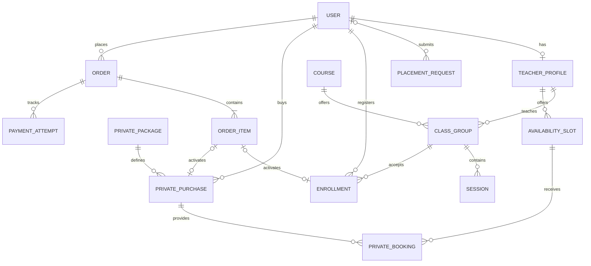

# Speakora — Database Design

Status: Initial design, before implementation.

## Authentication

- Use Django's AbstractUser.
- Sign in with a unique username and password.
- Require a unique email address for password recovery.
- Manage roles and permissions through Django Groups.
- A user can be both a student and a teacher.

## Relationships



## Business Rules

- Placement requests do not require an account.
- Each order item references exactly one group enrollment or private purchase.
- An enrollment or private purchase can belong to at most one order item.
- Store purchased titles, prices, session counts and durations as snapshots.
- Each availability slot permits at most one active booking.
- A teacher's availability slots must not overlap.
- Private bookings cannot exceed the purchased session allowance.
- Activate purchases only after server-side payment verification.
- Repeated payment verification must not duplicate activation or credit.
- Unpaid group reservations expire and release their capacity.

## Decisions Still Required

- Cancellation and refund policies.
- Private package expiry rules.
- Group reservation payment deadline.
- Currency and payment gateway.
- Scheduling rules for private packages.
```